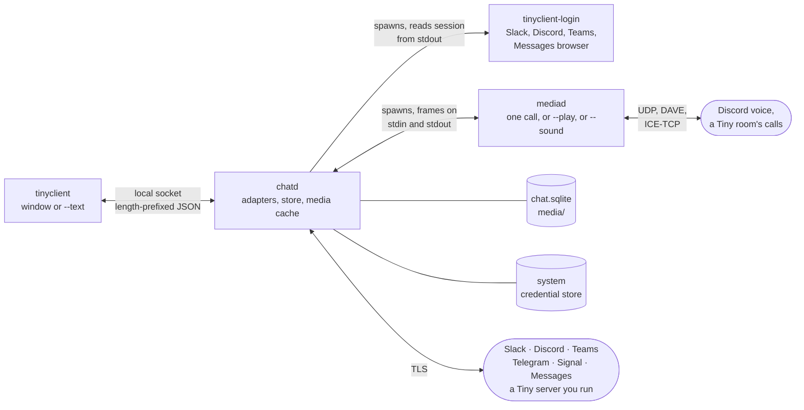

<div align="center">


# tinyclient

**One native app for Slack, Discord, Telegram, Teams, Signal, and Messages. Small, local, and open source.**

[](https://github.com/TinyComms/tinyclient/actions/workflows/ci.yml)
[](https://github.com/TinyComms/tinyclient/releases/latest)
[](LICENSE)

[Website](https://tinyclient.io) ·
[Discord](https://discord.gg/kJHK7BNvJP) ·
[Releases](https://github.com/TinyComms/tinyclient/releases) ·
[Architecture](docs/architecture.md) ·
[Contributing](CONTRIBUTING.md) ·
[Security](SECURITY.md)

</div>

tinyclient is a chat client written in Rust. It signs in to Slack, Discord, Telegram, Microsoft Teams, Signal, and Android Messages, and shows them in one window with one design. It runs on your machine. It talks to each of those networks directly. There is no tinyclient server, and nothing you type is sent to one. You can add [Tiny servers](https://github.com/TinyComms/tinyserver) you already run. That sign-in talks only to the server and, in your browser, the OpenID Connect provider that server uses. It is built for macOS, Linux, and Windows.

The project is early. The goal is a client that is a pleasure to use and does everything the official apps do, on every network, while staying small. Talk with us on [Discord](https://discord.gg/kJHK7BNvJP), or [come help](#contributing).

## Contents

- [Why](#why)
- [What works today](#what-works-today)
- [Work in progress](#work-in-progress)
- [Install](#install)
- [Keyboard shortcuts](#keyboard-shortcuts)
- [Build from source](#build-from-source)
- [Try it without an account](#try-it-without-an-account)
- [Architecture](#architecture)
- [Repository map](#repository-map)
- [Privacy and security](#privacy-and-security)
- [Networks and terms](#networks-and-terms)
- [Contributing](#contributing)
- [License](#license)

## Why

The official apps are several copies of a browser. tinyclient is one small daemon that holds the connections, and a native window that draws what the daemon reports.

- **Local first.** Messages are cached in SQLite on your disk. Sessions live in the system credential store. What you type goes to the networks you sign in to, or to a Tiny server you added. The window also asks GitHub whether a newer release exists, asks Wikipedia for a summary when a Wikipedia link has none, and, the first time a Tiny call encodes a picture, downloads Cisco's OpenH264 codec. None of those requests carries a message.
- **No telemetry.** No analytics, no usage pings, no crash upload. A panic is written, with credentials redacted, to a `crash.log` on your disk and nowhere else. About once an hour the window asks GitHub whether a newer release exists. That request sends only `User-Agent: tinyclient/<version>`. With automatic install on, the new copy is checked against the release's `SHA256SUMS` and replaces this one when you quit.
- **Small, with budgets.** Every feature has a memory, speed, and idle-CPU budget it must pass, measured from outside the process ([`docs/product/07-budgets-and-risk.md`](docs/product/07-budgets-and-risk.md)). The target for the whole product, idle and signed in to four networks, is **150 MB**. The budget for idle `chatd` is about one wakeup a second.
- **Calls cost nothing until you make one.** Voice runs in its own process, `mediad`, for the length of a call, and again as `mediad --play` while a voice message plays. No audio process is running the rest of the time.
- **Native, not Electron.** The window is [GPUI](https://github.com/zed-industries/zed), Zed's UI framework. Slack, Discord, and Teams sign in inside `tinyclient-login`, a separate process that exits when you are in. Signal, Telegram, and Messages sign in in the main window. Messages also opens Chrome, Edge, or Chromium for the Google account. A Tiny server's sign-in opens in your own browser.
- **Never acts for you.** No adapter sends a reaction, edit, friend request, or presence change you did not ask for. A conversation is marked read only when the window is active, the conversation is open, and the message is on screen. Telegram's own rules still send a read receipt and a typing indicator when you read and when you type. Signal sends those only as your Signal settings allow.

Sizes of a macOS arm64 release build, measured 2026-10-14. Later releases have not been measured again.

| Binary | Size | Runs |
| --- | --- | --- |
| `chatd` | 28 MB (Signal's libraries included) | always, in the background |
| `tinyclient` | 22 MB | while the window is open |
| `mediad` | 5.5 MB | during a call, or while a voice message plays |
| `tinyclient-login` | 1.8 MB | during a Slack, Discord, or Teams sign-in |

## What works today

Latest tagged release: [v0.2.35](https://github.com/TinyComms/tinyclient/releases/tag/v0.2.35). `main` is that release plus one commit: on a Tiny server that scans uploads, a file stays in the composer until the scan settles. The goal is full parity with each official app. Every gap is a place to help.

| Network | Sign-in | Reading and media | Writing | Calls |
| --- | --- | --- | --- | --- |
| **Discord** | Discord's web sign-in page | Servers, channels, threads, DMs, friends with presence, avatars, images, files, GIFs, link cards, reactions, replies, pins, profiles. The server list shows voice channels and who is in them. | Text, replies, threads, files, reactions, edit, delete, friend requests, your own status, mute, leave | Voice in direct messages, group DMs, and voice channels, with Discord's end-to-end encryption (DAVE). Mute and deafen. Echo cancellation, noise suppression, and automatic gain are on until you turn them off. Join a voice channel from its row. Stage channels open in Discord. Audio only. |
| **Slack** | Slack's web sign-in page. Every workspace of one sign-in. | Sections, channels, threads, DMs, avatars, files, GIFs, reactions, pins | Text, replies, reply in thread, files, reactions, edit, delete, your own status, mute | Huddles open in Slack |
| **Teams** | Microsoft's sign-in page. Work and school accounts only. | Teams, channels, chats, reply chains as threads, presence. Giphy GIFs play. | Text, files through OneDrive, reactions, edit, delete, mute, and a thread started from a channel message | Calls and meetings open in Teams |
| **Telegram** | QR code from your phone, or a phone number and code, plus a 2FA password | Chats, folders, topics, photos, pins. Saved Messages is your own notes. | Text, files, reactions, edit, delete, mute, leave | Calls open in Telegram. Secret chats are not supported. |
| **Signal** | Linked as a device. Scan a QR code from your phone. | Direct and group chats, replies, mentions, reactions, edits, deletes. Photos and files appear as a labelled line. Nothing from before the link. Your own chat is **Note to Self**, including messages sent from your phone. | Text, replies, reactions, edit and delete your own | Not built |
| **Messages** | A Google account in Chrome, Edge, or Chromium, then the emoji on your Android phone. A QR code when the phone still shows a scanner. The phone stays the account and has to stay online. | Texts in the chats the phone already has. Photos are shown. Video, audio, and other files are named and can be opened. | Text, one file at a time, reactions. A large photo may be sent as a smaller copy. | Opens in Messages on the phone |
| **Tiny server** | A code from an invite, or the server address, then your browser and that server's OpenID Connect provider. More than one server. | Rooms and who is in each, people with presence, text channels and direct messages, invites, roles, and the audit log when your account may see them. | Text, replies, files, reactions, edit, delete, a direct message from a profile, typing in a direct message. Make, rename, and delete rooms, invite, change roles, and the moderation that server allows. A server that scans files holds the send until the scan settles. | Join a room's call with audio when the server has it on, over UDP or, where UDP is blocked, ICE-TCP. Mute, deafen, see who is speaking, and leave. Echo cancellation, noise suppression, and automatic gain default on. End-to-end encryption when the server runs it. Camera and screen share on a room that allows video: one picture in, a share or the active speaker's camera. Sending a camera is Windows only. Screen share is Windows, macOS, and Linux on X11. On a server without audio, joining only takes a seat. |

A few behaviours that are easy to miss:

- **Animated images.** GIFs, animated WebP, and APNG play where pictures are drawn. Settings, under Messages, chooses when they play: automatically, on hover, or never. A Slack GIF uses Slack's moving copy. A Teams GIF from the Giphy button is a GIF.
- **Voice messages play**, with their waveform, at 1×, 1.5×, and 2×. Telegram's and Discord's, through `mediad --play`, one at a time.
- **Discord's server list** waits until chats have loaded before it shows cached servers, so a cold start does not flash an empty or stale tree. A voice channel joins from a hover Join pill, a double-click, or "Join voice" in the row's menu.
- **Signal's Note to Self.** A cached self-conversation is relabelled when the account reconnects. Its messages stay. A contact's new identity key is trusted, because safety numbers are not shown yet.
- **Search.** `tinyclient --text --search` searches message text in the local cache, newest hits first. In the window, the Edit menu's Find opens the search pane: this conversation (Command-F), everywhere (Shift-Command-F; Ctrl-F, Ctrl-Shift-F elsewhere), and the switcher's "Search messages" row lands there too. A hit opens its conversation on that message. Enter asks the network when that network has a search: Discord's own search for a server or for one channel, and Telegram's search for one conversation. Everywhere else, Enter still reads the cache.
- **Terminal.** `tinyclient --text`, or any build without the `gui` feature, prints account status and the inbox as lines of text. An interactive terminal UI is not built. The socket protocol is enough to write one.
- **Platforms.** CI builds and tests macOS, Linux, and Windows on every push (`.github/workflows/ci.yml`). Releases ship a macOS app, a Windows installer, and Linux x86_64 and aarch64 packages (`.deb`, `.rpm`, AppImage, `.tar.gz`). The site's macOS download is Apple silicon. Linux web sign-in, including Discord's session capture, uses WebKitGTK. The main window closes on all three.
- **Notifications.** chatd posts them with the window closed: direct messages and mentions by default, one per conversation with its newest lines, withdrawn once read, with Reply and Mark as read. On Linux, a notification server without inline reply shows Mark as read alone. Calls ring with Accept and Decline. Settings › Notifications holds what notifies, previews (and on a locked screen), pauses, and quiet hours. Sounds picks the message, mention, and ring sounds. The taskbar button (Dock icon on macOS) shows the unread count and flashes for something new. macOS notifications need the app bundle.
- **A Tiny call that loses audio** stays in the call. It offers again after one second, then two, then three, and leaves once if those fail. Hanging up during the wait still leaves immediately.
- **A Tiny file on a server that scans uploads** stays in the composer, with "Scanning that file before it sends.", until the server accepts or refuses it. A server that does not scan keeps the earlier send. Archives go only to a scanning server that allows them.

## Work in progress

Look at [open pull requests](https://github.com/TinyComms/tinyclient/pulls) before you start something large. Say which area you want on [Discord](https://discord.gg/kJHK7BNvJP) so two people do not build the same thing.

Not built, on `main`:

| Work | Where it stands |
| --- | --- |
| **Camera and screen share outside Tiny** | Discord, Slack, Teams, Telegram, Signal, and Messages do not send or receive them. A Discord voice call refuses the request in words and stays a voice call. Stage channels, Slack huddles, Teams meetings, Telegram calls, and Messages calls open in the official app. |
| **Tiny video on every desktop** | A Tiny room can send and receive one H.264 picture. The camera captures on Windows only. Screen share captures on Windows, macOS, and Linux X11. A Wayland session cannot share the screen. macOS and Linux can still watch a picture and, on macOS and X11, send one. |
| **Signal attachments, safety numbers, and calls** | A photo or file is a labelled line, not a picture you can open. A new identity key is trusted automatically. Calls are not built. |
| **Teams personal accounts** | Work and school accounts only. |
| **Telegram secret chats** | Not supported. The library tinyclient uses does not implement them. |
| **Recording a voice message** | Telegram and Discord voice messages play. Recording one is not built. |
| **Search on the network** | The cache is searched everywhere. Enter asks Discord (a server or one channel) and Telegram (one conversation). Slack, Teams, Signal, and Messages are not asked. |

## Install

Download from [tinyclient.io](https://tinyclient.io), or from the [latest release](https://github.com/TinyComms/tinyclient/releases/latest). The site links and the release are the same files. A `v*` tag runs [`.github/workflows/release.yml`](.github/workflows/release.yml), which publishes every package below with a [`SHA256SUMS`](https://tinyclient.io/download/checksums) file. The workflow installs and starts each package on a clean system before it publishes the release.

| OS | Download | What it is |
| --- | --- | --- |
| macOS 13 or later, Apple silicon | [`tinyclient-macos.dmg`](https://tinyclient.io/download/macos) ([`.zip`](https://tinyclient.io/download/macos-zip)) | `tinyclient.app`, to drag to Applications |
| Debian, Ubuntu, x86_64 | [`tinyclient-linux-x86_64.deb`](https://tinyclient.io/download/deb) | `sudo apt install ./tinyclient-linux-x86_64.deb` |
| Debian, Ubuntu, arm64 | [`tinyclient-linux-aarch64.deb`](https://tinyclient.io/download/deb-arm64) | `sudo apt install ./tinyclient-linux-aarch64.deb` |
| Fedora, openSUSE, x86_64 | [`tinyclient-linux-x86_64.rpm`](https://tinyclient.io/download/rpm) | `sudo dnf install ./tinyclient-linux-x86_64.rpm` |
| Fedora, openSUSE, arm64 | [`tinyclient-linux-aarch64.rpm`](https://tinyclient.io/download/rpm-arm64) | `sudo dnf install ./tinyclient-linux-aarch64.rpm` |
| Any Linux, x86_64 | [`tinyclient-linux-x86_64.AppImage`](https://tinyclient.io/download/appimage) | One file: `chmod +x` it and run it |
| Any Linux, arm64 | [`tinyclient-linux-aarch64.AppImage`](https://tinyclient.io/download/appimage-arm64) | One file: `chmod +x` it and run it |
| Any Linux, x86_64 | [`tinyclient-linux-x86_64.tar.gz`](https://tinyclient.io/download/linux-tar) | The four programs and `install.sh` |
| Any Linux, arm64 | [`tinyclient-linux-aarch64.tar.gz`](https://tinyclient.io/download/linux-tar-arm64) | The four programs and `install.sh` |
| NixOS, Nix on Linux | [`flake.nix`](flake.nix) | Built from source. See [Nix](#nix). |
| Windows 10 or later, x86_64 | [`tinyclient-windows-x86_64-setup.exe`](https://tinyclient.io/download/windows) | Installer for the current user. Settings, Apps uninstalls it. |
| Windows, portable | [`tinyclient-windows-x86_64.zip`](https://tinyclient.io/download/windows-portable) | The four `.exe` files, run in place |

There is no macOS Intel build and no Windows arm64 build. Linux arm64 files use `aarch64` in the name. The `.deb` and `.rpm` package name is `tinyclient` on both architectures.

Linux packages are built on Ubuntu 22.04, so they need that glibc or newer. The release workflow then installs the `.deb` on Ubuntu 24.04 and Debian 12, and the `.rpm` on current Fedora and openSUSE Tumbleweed, on x86_64 and arm64. The `.deb` and `.rpm` bring in the libraries they were linked against. The AppImage and `.tar.gz` use the system's GTK 3, WebKitGTK 4.1, ALSA, OpenSSL 3, and Vulkan.

The four programs stay in one directory: `tinyclient`, `chatd`, `mediad`, and `tinyclient-login`. Each finds the others beside itself. Start `tinyclient`. It starts `chatd` when nothing answers on the socket.

Put [`SHA256SUMS`](https://tinyclient.io/download/checksums) beside a download and check it:

```sh
sha256sum -c --ignore-missing SHA256SUMS
```

```sh
shasum -a 256 -c --ignore-missing SHA256SUMS
```

On Windows, `Get-FileHash tinyclient-windows-x86_64-setup.exe` and compare the hash with that file's line in `SHA256SUMS`.

- **macOS.** Open the disk image and drag `tinyclient` to Applications. The `.zip` is the same app. The app is signed ad hoc, so the first open can be refused. If you trust the build, allow it under System Settings, Privacy & Security, Open Anyway. Open the app. macOS grants the microphone to an app bundle, so calls need the bundle.
- **Linux packages.**

  ```sh
  sudo apt install ./tinyclient-linux-x86_64.deb
  sudo apt remove tinyclient
  ```

  ```sh
  sudo dnf install ./tinyclient-linux-x86_64.rpm
  sudo zypper install --allow-unsigned-rpm ./tinyclient-linux-x86_64.rpm
  sudo dnf remove tinyclient
  ```

  On openSUSE, `zypper remove tinyclient` removes it. The packages are not in a repository and are not signed. Install a newer download the same way to upgrade. Use the `aarch64` file name on arm64. The apt and rpm package name stays `tinyclient`.

- **AppImage.** `chmod +x` the file and run it. Delete the file to remove it. Without FUSE, add `--appimage-extract-and-run`. The sign-in window needs WebKitGTK 4.1.
- **`.tar.gz`.**

  ```sh
  tar -xzf tinyclient-linux-x86_64.tar.gz
  cd tinyclient
  ./install.sh
  sudo ./install.sh --system
  ```

  `./install.sh` installs for you, under `~/.local`. `--system` installs for everyone, under `/usr/local`. Run `install.sh` from a newer archive to upgrade. Remove a user install with `~/.local/lib/tinyclient/install.sh --uninstall`. Remove a system install with `sudo /usr/local/lib/tinyclient/install.sh --uninstall --system`. You can also run `./tinyclient` from the unpacked directory.
- **Linux session.** Sign-ins are kept in the Secret Service (GNOME Keyring or KWallet), service `tinyclient`, and the keyring has to be unlocked in the login session. The sign-in window needs WebKitGTK 4.1 and supports Wayland and X11. On Linux, a short D-Bus timeout while the keyring waits is retried for up to two minutes (`crates/chatd/src/session.rs`).
- **Windows.** Run `tinyclient-windows-x86_64-setup.exe`. It installs for the current user, in `%LOCALAPPDATA%\Programs\tinyclient`, without an administrator, and adds a Start menu entry. The installer is not code-signed, so SmartScreen can warn. If you trust the build, choose More info, Run anyway. Upgrade by running a newer installer. Uninstall in Settings, Apps. A scripted per-user install is `tinyclient-windows-x86_64-setup.exe /VERYSILENT /CURRENTUSER`. The portable `.zip` unpacks to one folder. Run `tinyclient.exe` there, and delete the folder to remove it. The sign-in window needs WebView2, which current Windows includes.

### Updates

While the window is open it asks GitHub whether a newer release exists, shortly after launch and about once an hour. The request user agent is `tinyclient/<version>`. It sends no account and no machine id.

The address compiled into this copy is the old repository feed in `crates/tinyclient/src/update.rs`. GitHub currently redirects that request to [TinyComms/tinyclient](https://github.com/TinyComms/tinyclient), and the release it returns is the one the site serves.

The in-app download exists for three builds:

| This copy | Archive it downloads |
| --- | --- |
| macOS, Apple silicon | `tinyclient-macos.zip` |
| Linux x86_64 | `tinyclient-linux-x86_64.tar.gz` |
| Windows x86_64 | `tinyclient-windows-x86_64.zip` |

Linux arm64 does not ask GitHub. A development build under `target/`, and any copy in the Nix store, is never replaced. A directory this user cannot write, including `/usr/lib/tinyclient` from the `.deb` and `.rpm`, is not replaced either. The window can still say a release is available. Install the newer package, or the newer archive, yourself.

When a download is allowed, it is checked against that release's `SHA256SUMS`. On macOS the new app is checked with `codesign --verify --deep --strict` before it is kept. It replaces this copy when you quit. The menu then says Restart to Update. On Windows the swap waits until the programs from that folder have stopped, puts the old programs back if a step fails, and opens tinyclient again either way.

The published Linux `.tar.gz` has a top-level `tinyclient/` directory, which is what `install.sh` expects. The updater looks for `tinyclient` and `chatd` at the top of the extract. Until those layouts agree, upgrade a `.tar.gz` install by running `install.sh` from the new archive. Upgrade a `.deb` or `.rpm` by installing the new package. If the systemd user service is enabled, restart it after the new binaries are in place (`systemctl --user restart tinyclient-chatd.service`).

A release with the same version number is offered when this build's commit is older than that tag. About shows the version and the commit. Nix upgrades by building the newer flake. The updater does not write the Nix store.

### Optional systemd user service on Linux

The `.deb` and `.rpm` install `tinyclient-chatd.service` to `/usr/lib/systemd/user/`. The Nix package installs the same unit under its store path. The unit is disabled until you enable it. With it disabled, tinyclient starts its own daemon, logs to `chatd.log`, and stops that daemon when the application quits.

The AppImage and the `.tar.gz` do not install the unit. For a source build or an archive install, copy [`packaging/linux/tinyclient-chatd.service`](packaging/linux/tinyclient-chatd.service) to `~/.config/systemd/user/`, set `ExecStart` to the absolute path of that `chatd`, and reload the user manager. Keep the four programs together. Leave an AppImage on automatic startup.

To let systemd manage the daemon, quit tinyclient first so its daemon releases the socket. From a terminal in the graphical session:

```sh
systemctl --user daemon-reload
systemctl --user import-environment WAYLAND_DISPLAY DISPLAY XDG_CURRENT_DESKTOP
systemctl --user enable --now tinyclient-chatd.service
journalctl --user -u tinyclient-chatd.service -f
```

Import only the variables your session sets. Wayland sets `WAYLAND_DISPLAY`. X11 sets `DISPLAY`. If you use `XDG_DATA_HOME`, import that too, so the window and the daemon share a data directory. The Secret Service provider has to be running and unlocked on the same user session bus.

When `systemctl --user is-enabled tinyclient-chatd.service` reports `enabled`, opening tinyclient asks systemd to start the daemon. A failed start does not spawn a second daemon. Quitting the window leaves the daemon receiving. Restart the service after upgrading the binaries. To stop background activity, quit the window and run `systemctl --user stop tinyclient-chatd.service`.

The unit is `PartOf` and `WantedBy` `graphical-session.target`. Desktops that manage that target start and stop it with the graphical session. With a standalone compositor, import the display environment after the compositor starts, then start the service, and stop it when you leave the session. Repeat the import on each login so sign-in helpers see the current display. Do not enable lingering for this service: sign-in windows need a live graphical session.

To return to automatic startup, quit the window and run:

```sh
systemctl --user disable --now tinyclient-chatd.service
```

For sign-in diagnostics, import `TINYCLIENT_LOGIN_DEBUG=1` into the user manager and restart the service. Watch the journal, then unset it:

```sh
TINYCLIENT_LOGIN_DEBUG=1 systemctl --user import-environment TINYCLIENT_LOGIN_DEBUG
systemctl --user restart tinyclient-chatd.service
systemctl --user unset-environment TINYCLIENT_LOGIN_DEBUG
systemctl --user restart tinyclient-chatd.service
```

`TINYCLIENT_DIR` and `TINYCLIENT_CHATD` always start `chatd` directly.

On NixOS or Home Manager, prefer the module in the [Nix](#nix) section over copying the unit by hand.

### Nix

The flake builds tinyclient from source on `x86_64-linux` and `aarch64-linux`. It does not build a macOS app. Intel Macs are not a supported flake system.

```sh
nix profile add github:TinyComms/tinyclient
nix profile remove tinyclient
```

With Home Manager, import `inputs.tinyclient.homeManagerModules.default` and set:

```nix
programs.tinyclient.enable = true;
programs.tinyclient.systemd.enable = true; # optional chatd user service
```

`programs.tinyclient.systemd.enable` adds the user service above, with `chatd` from the Nix package. Leave it unset to keep automatic startup.

Published Linux and Windows and macOS builds are compiled with a Telegram app id. A Nix build is not. Telegram stays unavailable until you override the package:

```nix
programs.tinyclient.package = inputs.tinyclient.packages.${pkgs.stdenv.hostPlatform.system}.default.override {
  telegramApiId = "12345";
  telegramApiHash = "0123456789abcdef0123456789abcdef";
};
```

Both values end up in the Nix store. On NixOS, the window needs `hardware.graphics.enable`.

The updater never replaces `/nix/store`. Upgrade by building this flake again.

## Build from source

Prerequisites:

- Rust, current stable, through [rustup](https://rustup.rs). There is no `rust-toolchain.toml`. CI uses stable on Ubuntu 22.04, macOS, and Windows.
- `protoc` on the `PATH` for the default Signal build. Signal's libraries compile protobufs at build time, and the compiler has to accept proto3 optional fields. CI installs [protoc 29.3](packaging/ci/protoc.sh) on Linux, macOS, and Windows. Ubuntu 22.04's `protobuf-compiler` is 3.12 and cannot compile them, so do not use that package for a Signal build. On macOS, `brew install protobuf` is enough when Homebrew's bottle is a current protoc. `cargo build -p chatd --no-default-features` leaves Signal out and does not need `protoc`.
- macOS: the Command Line Tools. The window builds with GPUI's runtime shaders, so Xcode's Metal compiler is not required.
- Linux, the libraries CI installs to compile (`packaging/ci/apt.sh`, without the packaging tools):

  ```sh
  sudo apt-get install build-essential pkg-config libssl-dev libasound2-dev libgtk-3-dev \
    libwebkit2gtk-4.1-dev libsoup-3.0-dev libvulkan-dev libwayland-dev libxkbcommon-dev libxkbcommon-x11-dev \
    libx11-dev libxcb1-dev libfontconfig1-dev
  ```

- Windows: `protoc` on the `PATH`. The sign-in window uses WebView2, which current Windows includes (`packaging/windows.ps1`).
- Or, with Nix, `nix develop` (or `direnv allow`, which loads the flake from `.envrc`) provides Rust, `protoc`, and the Linux libraries.

Then:

```sh
git clone https://github.com/TinyComms/tinyclient
cd tinyclient
cargo test --workspace                     # every crate; no GPU stack
cargo build -p chatd -p mediad -p login    # the daemon and its helpers
cargo run -p tinyclient --features gui     # the window; starts the chatd beside it
cargo run -p tinyclient                    # status and inbox as text, if chatd is already listening
```

`cargo test --workspace` is what CI runs. It does not build the GPU stack. On macOS, CI also runs `cargo test -p tinyclient --features gui`. Build `chatd` before the window: the window starts the `chatd` that sits beside `tinyclient` in `target/<profile>/`, or the one named by `TINYCLIENT_CHATD`. The text shell does not start chatd. If nothing is listening it says so and tells you to run `cargo run -p chatd`.

Develop against a scratch data directory. See [Try it without an account](#try-it-without-an-account).

Release binaries, the same cargo line CI and the release workflow use:

```sh
cargo build --release -p tinyclient --features tinyclient/gui -p chatd -p mediad -p login
```

A release `chatd` also needs a Telegram app id in the environment. See [Telegram needs your own app id](#telegram-needs-your-own-app-id).

The packages those binaries go into:

```sh
packaging/bundle.sh && packaging/dmg.sh dist/tinyclient.dmg   # macOS: target/release/tinyclient.app, then a disk image
eval "$(packaging/linux/tools.sh)" && packaging/linux.sh      # Linux: .deb, .rpm, AppImage, .tar.gz in dist/
packaging\windows.ps1                                         # Windows: Inno Setup 6 installer and .zip in dist\
```

`bundle.sh` reads `TINYCLIENT_TELEGRAM_API_ID` and `TINYCLIENT_TELEGRAM_API_HASH` from the environment, or from `~/.config/tinyclient/telegram.env` (override the path with `TINYCLIENT_TELEGRAM_ENV`). `linux.sh` and `windows.ps1` do not read that file; export the variables yourself. Linux packaging also needs `librsvg2-bin`, `dpkg-dev`, and `patchelf`. `tools.sh` downloads nfpm and appimagetool. Windows packaging needs Inno Setup 6 (`iscc.exe`). On macOS, calls need the app bundle: the system grants the microphone to an app, and a program run from a terminal borrows the terminal's permission.

Feature flags:

| Crate | Feature | Effect |
| --- | --- | --- |
| `chatd` | `signal` (default) | Links presage, libsignal-service-rs, and libsignal (AGPL-3.0). `cargo build -p chatd --no-default-features` leaves Signal out. The sheet then says this build was made without Signal. |
| `tinyclient` | `gui` | The GPUI window. Without it the binary prints status and the inbox as text, and it does not start chatd. |
| `tinyclient` | `gui-shot` | Adds `--shot out.png`: render the window to a file and quit, for design review and driven tests. Such a shell never marks anything read, and it does not start chatd unless you pass `--start-chatd`. |

### Telegram needs your own app id

Telegram asks every client to register an app id, and the id is not in this repository. Register one at [my.telegram.org](https://my.telegram.org). Telegram's rules say the app name must not contain "Telegram". Put both values in the environment when you build `chatd`:

```sh
TINYCLIENT_TELEGRAM_API_ID=12345 TINYCLIENT_TELEGRAM_API_HASH=0123456789abcdef0123456789abcdef cargo build -p chatd
```

The id has to be a positive 32-bit integer. The hash has to be non-empty. Both are compiled into `chatd`. A debug or test build may omit them: Telegram is then unavailable, and the sheet says this build was made without a Telegram app id. A release build refuses to compile without them. With [direnv](https://direnv.net), export both from `.envrc.local`, which `.envrc` loads and git ignores. For the Nix package, set `telegramApiId` and `telegramApiHash`; a package build is a release build, so it needs both.

A binary built this way carries your id, and Telegram holds its owner responsible for what the app does. Give it to other people only if you accept that.

### Signal and the AGPL

The `signal` feature of `chatd` is on by default. It links [presage](https://github.com/whisperfish/presage) (pinned in `crates/chatd/Cargo.toml`), libsignal-service-rs, and Signal's libsignal, which are AGPL-3.0, so a `chatd` built with it is a combined work under the AGPL. The source of this repository stays [MIT](LICENSE). The release binaries are built with the feature. The Windows zip includes `packaging/AGPL-3.0.txt`.

```sh
cargo build -p chatd --no-default-features
```

That leaves Signal out. Sign-in then says this build was made without Signal. The libraries need `protoc` only when the feature is on.

## Try it without an account

`TINYCLIENT_DIR` moves the socket, database, media cache, and logs to a directory you choose. chatd does not read or write the system credential store while it is set. Discord, Slack, Teams, and Messages sign-in is refused unless `TINYCLIENT_LOGIN` names a helper. A session cannot be saved. Use a scratch directory for development.

`--seed-demo` fills that directory with invented data and serves it: Discord, two Slack workspaces (Harbor Labs and Fernhill Collective), Telegram, Teams, Signal, and a Tiny server named Night Shift. `#showcase`, in Moss & Lichen, holds one of every kind of message. There is no network behind it (`crates/chatd/src/demo/adapter.rs`). The Tiny server's own requests are answered in-process.

chatd stays in the foreground. Start the window from a second terminal with the same `TINYCLIENT_DIR`, so it attaches to that process. Each `--seed-demo` run replaces the accounts it seeded.

```sh
TINYCLIENT_DIR=/tmp/tinyclient-demo cargo run -p chatd -- --seed-demo
TINYCLIENT_DIR=/tmp/tinyclient-demo cargo run -p tinyclient --features gui
```

On Windows PowerShell, set the variable first. Use a full path:

```powershell
$env:TINYCLIENT_DIR = Join-Path $env:TEMP 'tinyclient-demo'
cargo run -p chatd -- --seed-demo
```

In a second terminal, with the same directory:

```powershell
$env:TINYCLIENT_DIR = Join-Path $env:TEMP 'tinyclient-demo'
cargo run -p tinyclient --features gui
```

`--seed-demo=live` keeps the direct conversation with Yusuf Demirci moving, one step every few seconds: typing, a new message, a picture on every other message, a reaction, an edit, a presence change, and a mute in a voice channel. Other variants, comma separated: `expired` (one Slack workspace is expired), `many` (50 Discord servers), `attention` (Discord wants a verification), `reconnecting` (one Slack workspace is retrying). An unknown word is ignored and the rest still seed.

chatd refuses `--seed-demo` without `TINYCLIENT_DIR` and exits 64, so it cannot write to your real store.

Notifications stay off in a scratch directory. `TINYCLIENT_NOTIFY=on` turns them on.

With `TINYCLIENT_DIR` set, browser sign-in runs only a helper named by `TINYCLIENT_LOGIN`. Variants and the timing knobs (`TINYCLIENT_DEMO_VOICE`, `TINYCLIENT_DEMO_ANSWER_MS`, `TINYCLIENT_DEMO_UPLOAD_MS`, `TINYCLIENT_DEMO_SIGN_OUT_MS`) are listed under "The demo" in [`docs/architecture.md`](docs/architecture.md).

## Keyboard shortcuts

Shortcuts use Command on macOS and Ctrl on Linux and Windows. Menus, tooltips, and Settings → Shortcuts show the keys for this computer. Help → Keyboard Shortcuts (Command-/ , Ctrl-/ elsewhere) opens that page. Super is left to the Linux desktop.

The list in Settings shows the keys. It does not change them. Voice keys are the exception: Settings → Voice records push-to-talk, priority push-to-talk, toggle mute, and toggle deafen. On Wayland those mute and deafen keys work while the window is in front, and push-to-talk does not.

Full screen is Control-Command-F on macOS and Ctrl-Alt-F on Linux and Windows. Quick Switcher is Command-K on macOS and Ctrl-K elsewhere. Its field reads “Jump to a conversation, a person or a server”.

Keys below are written with macOS glyphs. On Linux and Windows, Command becomes Ctrl, Option becomes Alt, and Control-Command becomes Ctrl-Alt. Hide tinyclient and Hide Others exist on macOS only. Inbox and People are Command-1 and Command-2. Further places on the rail take Command-3 through Command-9 in rail order.

| Menu | Command | Keys |
| --- | --- | --- |
| tinyclient | Settings… | ⌘, |
| tinyclient | Quit tinyclient | ⌘Q |
| File | New Message | ⌘N |
| File | Attach File… | ⌘U |
| File | Close Window | ⌘W |
| Edit | Undo / Redo | ⌘Z / ⇧⌘Z |
| Edit | Cut, Copy, Paste, Select All | ⌘X ⌘C ⌘V ⌘A |
| Edit | Search in Conversation | ⌘F |
| Edit | Search Everywhere | ⇧⌘F |
| View | Quick Switcher | ⌘K |
| View | Hide Sidebar | ⌘\ |
| View | Close Right Pane | ⌘. |
| View | Bigger Text, Smaller Text, Actual Size | ⌘+ ⌘− ⌘0 |
| View | Enter Full Screen | ⌃⌘F |
| Conversation | Back / Forward | ⌘[ / ⌘] |
| Conversation | Up a Level | ⌘↑ |
| Conversation | Next / Previous | ⌥↓ / ⌥↑ |
| Conversation | Next Unread / Previous Unread | ⌥⇧↓ / ⌥⇧↑ |
| Conversation | Mark as Read | ⇧Esc |
| Conversation | Show Details | ⌥⌘I |
| Conversation | Start Call | ⇧⌘C |
| Conversation | Open in App | ⌥⌘O |
| Window | Minimize | ⌘M |
| Calls | Mute, Deafen, Leave | ⇧⌘M / ⇧⌘D / ⇧⌘H |
| Calls | Accept, Decline, Go to the call | ⇧⌘A / ⇧⌘R / ⇧⌘J |

In the composer, Command-E opens emoji and Command-Shift-G opens GIFs (Ctrl-E and Ctrl-Shift-G elsewhere).

Text fields use the platform’s editing keys. On Linux and Windows those include Ctrl-C, Ctrl-V, Ctrl-X, Ctrl-A, and Ctrl-Z, Ctrl-Left and Ctrl-Right to move by word, and Home and End to move within a line. On macOS, Option-Left and Option-Right move by word, and Command-Left and Command-Right move to the ends of the line.

Settings → Messages → Send with chooses Return (the default) or Command-Return. With Command-Return selected, Return inserts a line. Shift-Return inserts a line in the default. Command-Return, or Ctrl-Enter on Linux and Windows, always sends.

## Architecture



A [Tiny server](https://github.com/TinyComms/tinyserver) is one you already run. The client is [tinyclient](https://github.com/TinyComms/tinyclient).

| Crate | Binary | Role |
| --- | --- | --- |
| [`protocol`](crates/protocol) | | The contract: every request, answer, and change, as serde types. Frames are a 4-byte length, then JSON, at most 1 MiB, over a Unix socket (a named pipe on Windows). Also the panic hook, credential redaction, and how the shell starts chatd. |
| [`chatd`](crates/chatd) | `chatd` | Always on, one per data directory (`chatd.lock`). One adapter per account speaks that network's protocol. Everything lands in SQLite and the media cache. Spawns `tinyclient-login` for Slack, Discord, and Teams, and for the Messages browser step. Spawns `mediad` for a call, a voice message, or a notification sound. Never decodes media and never fetches a link from a message. |
| [`mediad`](crates/mediad) | `mediad` | Voice: Discord's voice gateway, RTP over UDP, Opus, DAVE, and a Tiny server's room calls through str0m — UDP, or ICE-TCP where UDP is blocked — audio devices through cpal. `mediad --play` plays one voice message or audio file. `mediad --sound` plays one notification sound. Speaks only to chatd over stdin and stdout, and exits when its job ends or chatd closes its stdin. |
| [`login`](crates/login) | `tinyclient-login` | The sign-in page for Slack, Discord, and Teams in a native web view (WKWebView on macOS, wry elsewhere). Prints the session on stdout and exits. The same binary opens Chrome, Edge, or Chromium for Messages. Signal and Telegram sign in in the main window. A Tiny server collects the invite or address in that window, then opens the server's sign-in provider in the system browser, driven by chatd. |
| [`notifier`](crates/notifier) | | Library, not a process. System notifications for chatd, and the taskbar button or Dock icon for the window. |
| [`tinyclient`](crates/tinyclient) | `tinyclient` | The shell. Draws what chatd reports and decodes images for rows on screen. GPUI is behind the `gui` feature so tests and the daemons never build a GPU stack. Does not read the database. While the window is open it asks GitHub whether a newer release exists, about once an hour, with user agent `tinyclient/<version>`. |

The shell learns about changes by long-polling. `Wait {since}` blocks for up to 30 seconds and answers every change newer than `since`. The full contract, the data each process may hold, and what an adapter must do are in [`docs/architecture.md`](docs/architecture.md).

There is no adapter trait. An adapter is a module under `crates/chatd/src/adapters/` that exports `accounts`, `without`, and `start`, and talks to chatd through `Command` and `Context`. The seven networks are Discord, Slack, Teams, Telegram, Signal, Messages, and Tiny. [CONTRIBUTING.md](CONTRIBUTING.md) walks through adding one.

## Repository map

| Path | What it is |
| --- | --- |
| [`crates/protocol`](crates/protocol) | Socket types shared by every process. A new field is optional, so an older frame still reads. |
| [`crates/chatd`](crates/chatd) | Adapters, the SQLite store, the media cache, and the demo. Network tests live in `crates/chatd/tests/`. Hand-written payloads for Discord, Slack, and Teams live in `crates/chatd/tests/fixtures/`. |
| [`crates/mediad`](crates/mediad) | The call process. Call tests run it against a generated tone and a fake voice server, and a Tiny room against a small in-test SFU. |
| [`crates/notifier`](crates/notifier) | Notifications and the taskbar or Dock icon. chatd decides what to post. |
| [`crates/login`](crates/login) | The sign-in helper. |
| [`crates/tinyclient`](crates/tinyclient) | The window, the text shell, and the in-app updater. |
| [`docs/`](docs) | The spec: architecture, product stories, and the visual system, plus `reconnecting.md` and `proposals/`. A choice the docs leave open is settled there, by agreement, before the code. |
| [`packaging/`](packaging) | The icon, the macOS bundle, Linux and Nix packages, the Windows installer, sounds, and the systemd unit `packaging/linux/tinyclient-chatd.service`. |
| [`site/`](site) | [tinyclient.io](https://tinyclient.io). Pages are static. `site/_worker.js` serves Markdown to clients that ask for it. |
| [`.github/workflows/`](.github/workflows) | CI on every push, the release workflow on a `v*` tag, and the site deploy. |

## Privacy and security

tinyclient runs on your computer. There is no tinyclient service in the middle of a chat. [tinyclient.io](https://tinyclient.io) does not issue access tokens, does not accept credentials, and does not proxy messages. The site is static, sets no cookies, and runs no analytics. Cloudflare Pages hosts it and can see a request the way any web host can.

A [Tiny server](https://tinyclient.io/tinyserver) you add is run by its owner, with its own sign-in provider. The website has no part in that server.

| What | Where | Protected by |
| --- | --- | --- |
| Sessions (tokens, cookies, Teams refresh tokens, Telegram keys) | macOS login keychain, Windows Credential Manager, or the Linux Secret Service. Service `tinyclient`, one item per network. Slack workspaces share one item. Every Tiny server on that sign-in shares one item. | The OS credential store. Not written to the database. A build whose store would not persist refuses to keep sessions. |
| Signal keys, sessions, contacts, groups | `signal/<account>.state` in the data directory | Each value sealed with AES-256-GCM-SIV under a key that only the credential store item holds. On Unix the directory is mode `0700` and the file is mode `0600`. |
| Messages, conversations, people | `chat.sqlite` in the data directory | Not encrypted. Relies on disk encryption (FileVault, BitLocker, LUKS) and the permissions of your home directory. |
| Avatars and attachments you looked at | `media/` in the data directory. The default cap is 500 MB. Settings can set 250, 500, 1000, or 2000 MB. | Not encrypted, as above |
| Crash reports and chatd's log | `crash.log`, `chatd.log` in the data directory | Passed through `protocol::redact` before writing. That removes Slack, Discord, and Teams tokens, JWTs, authorization headers, signed URL parameters, and Signal's passwords and keys. Nothing is uploaded. |
| The sign-in window's browser data | A WebKit data store on macOS. `login/<network>/` in the data directory on Linux and Windows. | Kept so an interrupted sign-in resumes. Not removed on sign-out. |

The data directory is `~/Library/Application Support/tinyclient` on macOS, `$XDG_DATA_HOME/tinyclient` (default `~/.local/share/tinyclient`) on Linux, and `%APPDATA%\tinyclient` on Windows, or `TINYCLIENT_DIR` when set.

- **Chats** go to the networks you sign in to, and to a Tiny server you added, if you added one. They do not go to tinyclient.io.
- **Update check.** About once an hour while the window is open, and again shortly after launch, the window asks GitHub's public releases API whether a newer release exists. Each of those requests sends only `User-Agent: tinyclient/<version>`. When the newest release has this copy's version, a second request asks GitHub's compare API about this build's commit. With automatic install on, and only for an installed copy, the archive is downloaded from that GitHub release, checked against `SHA256SUMS`, and on macOS checked with `codesign`, then replaces this copy when you quit.
- **Media** is fetched only from an allow-list of hosts in `crates/chatd/src/blobs/fetch.rs`, and a session's credentials go only to the hosts that need them. Discord's GIF search returns cells on `media.tenor.com`. Teams' Giphy GIFs come from `giphy.com`. Link previews are the ones the network sends. chatd never fetches a URL from a message.
- **Sign-in** shows Slack, Discord, or Teams in a separate window, and that page loads what the network's page loads. Signal, Telegram, and Messages sign in in the main window. A Tiny server's sign-in opens in your browser, at the provider that server uses, and comes back once to chatd. chatd listens on `127.0.0.1` for that one request and then stops.
- **Calls** connect mediad to Discord's voice servers, or to the Tiny server's own media port. A Tiny server call is end-to-end encrypted only when that server offers `e2ee_calls` and every app in the call can do it. Otherwise the call says "Encrypted to the server". What that lock does and does not promise is in [SECURITY.md](SECURITY.md). When a Tiny call turns on screen share, camera, or watching a picture, and Cisco's OpenH264 library is not already on disk, mediad downloads it from Cisco. A voice-only call does not.
- **Messages** texts go through the paired Android phone. The phone has to stay online.
- **TLS** is the operating system's (Security.framework, SChannel, OpenSSL) for every network but Signal, whose libraries use rustls pinned to Signal's own certificate authority.
- **Retention.** By default, the newest 2,000 messages per conversation, and nothing older than 90 days unless you opened the conversation in that time. Settings can keep messages for 7, 30, or 90 days. Unsent messages stay. Signing out of an account asks the network to end the session where it can, takes that account out of the network's credential item, and deletes the item when it was the last account. It deletes that account's rows and its media files. The database is not vacuumed, so deleted text can remain in free pages of `chat.sqlite` until SQLite reuses them.
- **The local socket** is not authenticated. Any process running as your user can connect to it, as it can read your files.
- **Signal** does not show safety numbers yet, and a contact's new identity key is trusted automatically, as presage's own stores do.

How to report a vulnerability, and what is in scope: [SECURITY.md](SECURITY.md). Use [GitHub's private vulnerability reporting](https://github.com/TinyComms/tinyclient/security/advisories/new). A security problem is not a GitHub issue.

## Networks and terms

tinyclient is an independent project. It is not made or endorsed by Slack, Discord, Telegram, Microsoft, Signal, or Google. How each network treats third-party clients, so you can decide for yourself:

- **Slack.** Signs in the way Slack's web app does and uses that session. Slack does not offer an API for full clients, so a change on Slack's side can break this until we catch up. Work workspaces may have their own policy on clients.
- **Discord.** Discord's terms disallow third-party clients on user accounts. In practice its enforcement goes after automation, self-bots, and spam. tinyclient automates nothing. It only does what you do, and asks for members and presence only for what is on screen, like the official app. It identifies as Discord's web client in a browser, the same one you signed in with.
- **Teams.** Signs in as Microsoft's own Teams client. Your organization's policy applies, and an organization can turn third-party sign-ins off. Work and school accounts only.
- **Telegram.** Telegram welcomes third-party clients. Its rules mean read receipts and typing indicators are always sent. Secret chats are not supported. A build carries the Telegram app id of whoever built it.
- **Signal.** Links as one more device, like Signal Desktop, using Signal's own libsignal through presage. It never registers a phone number. It receives what arrives after it is linked, and signing out removes the device.
- **Messages.** Pairs this computer to Google Messages on an Android phone, the same kind of pairing messages.google.com uses. Google does not publish this protocol and can change it. The phone is the account: it has to stay online, and a text is sent through it. This is not iMessage, and it is not a second phone number.
- **A Tiny server.** Optional. Someone runs it for their own community. tinyclient is its app. tinyclient.io does not run it, does not take its credentials, and does not proxy its messages. There is no official app and no third-party terms of the kind above.

## Contributing

Contributions are welcome, from a typo to a network adapter.

1. Read [`docs/architecture.md`](docs/architecture.md), at least the first two sections, before changing anything that crosses a process boundary.
2. Pick an area from the [contributing page](https://tinyclient.io/docs/contributing), or from [work in progress](#work-in-progress). Say which one you want on [Discord](https://discord.gg/kJHK7BNvJP).
3. The product documents are the spec. A choice they leave open is settled there, by agreement, before the code.
4. Every change on `main` needs review from @itz4blitz, as [`.github/CODEOWNERS`](https://github.com/TinyComms/tinyclient/blob/main/.github/CODEOWNERS) says.

[CONTRIBUTING.md](CONTRIBUTING.md) covers building, testing, how the code is written, and how an adapter is put together. The repository is [TinyComms/tinyclient](https://github.com/TinyComms/tinyclient). Tests talk to a real `chatd` in a scratch directory, with each network replaced by a local fake. `cargo test --workspace` is what CI runs. It never builds the GPU stack. If you change the window, also run `cargo check -p tinyclient --features gui`.

There is no rustfmt configuration, and the code is not formatted with `cargo fmt`'s defaults. Do not reformat files you are not otherwise changing.

| Document | What it answers |
| --- | --- |
| [`docs/architecture.md`](docs/architecture.md) | How the processes fit, the socket contract, where data lives, what an adapter must do |
| [`docs/stories.md`](docs/stories.md) and [`docs/product/`](docs/product) | What is in the product and what is not built yet, per area, plus budgets and account risk |
| [`docs/design.md`](docs/design.md) and [`docs/design/`](docs/design) | The visual system, with an HTML mockup per area in `docs/design/mockups/` |
| [`CONTRIBUTING.md`](CONTRIBUTING.md) | Build, test, style, and adding an adapter |
| [`SECURITY.md`](SECURITY.md) | How to report a vulnerability |

## License

The source in this repository is [MIT](LICENSE). Copyright (c) 2026 Justin Scroggins. By contributing you agree that your contribution is licensed under that MIT license.

A `chatd` built with the default `signal` feature links AGPL-3.0 libraries (presage, libsignal-service-rs, and Signal's libsignal) and is distributed under the AGPL-3.0 as a combined work. The release binaries are built with that feature. `cargo build -p chatd --no-default-features` leaves Signal out.
