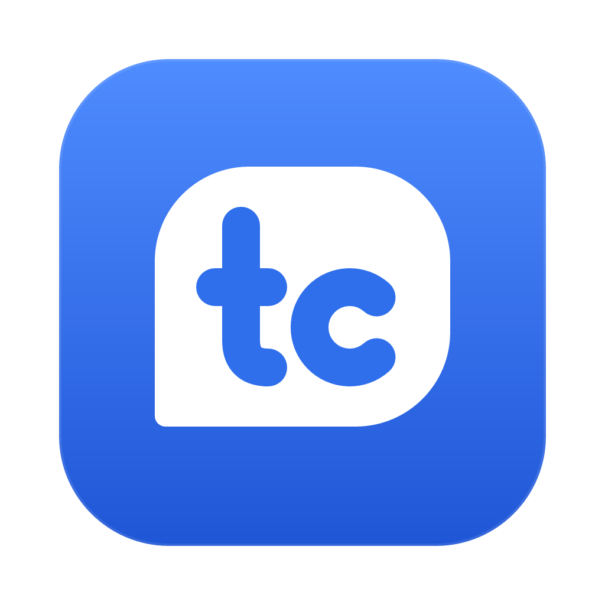
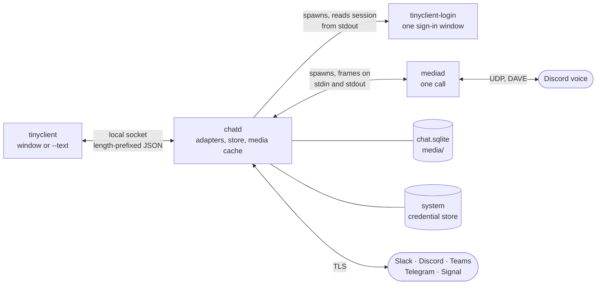

<div align="center">



# tinyclient

**One native app for Slack, Discord, Telegram, Teams and Signal. Small, local, and open source.**

[](https://github.com/itz4blitz/tinyclient/actions/workflows/ci.yml)
[](https://github.com/itz4blitz/tinyclient/releases/latest)
[](LICENSE)

[Website](https://itz4blitz.github.io/tinyclient/) ·
[Releases](https://github.com/itz4blitz/tinyclient/releases) ·
[Architecture](docs/architecture.md) ·
[Contributing](CONTRIBUTING.md) ·
[Security](SECURITY.md)

</div>

---

tinyclient is a chat client written in Rust. It signs in to your Slack workspaces, Discord,
Telegram, Microsoft Teams and Signal and shows them in one window with one design. It runs
entirely on your machine: it talks to each network directly, there is no tinyclient server,
and nothing is sent anywhere else. It is built for macOS, Linux and Windows.

It is early. Read [Status](#status) and [Read this before you sign in](#read-this-before-you-sign-in)
before you point it at an account you care about.

## Why

The official apps are five copies of a browser. tinyclient is one small daemon that holds the
connections and a native window that draws what the daemon reports.

- **Local first.** Messages are cached in SQLite on your disk. Sessions are kept in the system
  credential store. The only connections made are to the networks you sign in to.
- **No telemetry.** No analytics, no usage pings, no update check, no crash upload. A panic is
  written, with credentials redacted, to a `crash.log` on your disk and nowhere else.
- **Small, with budgets.** Every feature has a memory, speed and idle-CPU budget it must pass,
  measured from outside the process ([`docs/product/07-budgets-and-risk.md`](docs/product/07-budgets-and-risk.md)).
  The target for the whole product, idle, signed in to four networks, is **150 MB**. Measured on
  2026-10-13: `chatd` at 10 MB RSS signed in to Discord, the window at 64 MB RSS.
- **Calls cost nothing until you make one.** Voice runs in its own process, `mediad`, which
  exists only for the length of a call. No audio code is loaded the rest of the time.
- **Idle means idle.** Adapters block on their sockets and inboxes with no polling timers. The
  budget for `chatd` is about one wakeup a second for the whole process.
- **Native, not Electron.** The window is [GPUI](https://github.com/zed-industries/zed) (Zed's UI
  framework). The only web page tinyclient ever shows is a network's own sign-in page, in a
  separate process that exits when you are in.
- **Never acts for you.** No adapter sends a reaction, edit, friend request, read receipt or
  presence change you did not ask for. A conversation is marked read only when the window is
  active, the conversation is open and the message is on screen.

Sizes of a macOS arm64 release build of this tree, 2026-10-14:

| Binary | Size | Runs |
| --- | --- | --- |
| `chatd` | 28 MB (Signal's libraries included) | always, in the background |
| `tinyclient` | 22 MB | while the window is open |
| `mediad` | 5.5 MB | during a call only |
| `tinyclient-login` | 1.8 MB | during a sign-in only |

## Status

What the code does today, per network. Every row is covered by tests that run through chatd's
socket against local fakes of the network (`crates/chatd/tests/`). Real-account use is less even,
and the last column says so.

| Network | Sign-in | Reading | Writing | Calls | Used on a real account |
| --- | --- | --- | --- | --- | --- |
| **Discord** | Discord's web sign-in page | Servers, channels, threads, DMs, friends with presence, avatars, images, files, link cards, reactions, replies, pins, profiles | Text, replies, threads, files, reactions, edit, delete, friend requests, own status, mute, leave | Voice in DMs and voice channels, with Discord's end-to-end encryption (DAVE). Stage channels are not joined. | Reading: yes. Voice: never joined a real call yet. |
| **Slack** | Slack's web sign-in page; every workspace of one sign-in | Sections, channels, threads, DMs, avatars, files, reactions, pins | Text, replies, files, reactions, edit, delete, own status, mute | Huddles open in Slack | Yes |
| **Teams** | Microsoft's sign-in page. Work and school accounts only. | Teams, channels, chats, reply chains as threads, presence | Text, files (through OneDrive), reactions, edit, delete, mute | Calls and meetings open in Teams | Not yet |
| **Telegram** | QR code from your phone, or phone number and code; 2FA password | Chats, folders, topics, photos, pins | Text, files, reactions, edit, delete, mute, leave | Calls open in Telegram | Not yet |
| **Signal** | Linked as a device: scan a QR code from your phone | Direct and group chats, replies, mentions, reactions, edits, deletes. Photos and files appear as a labelled line, not shown. Nothing from before the link. | Text, replies, reactions, edit and delete your own | Not built | Not yet |

Not built yet: message search (the switcher finds conversations by title in the local cache),
notifications and a dock badge, video and screen share, voice messages, Signal attachments and
safety numbers, Teams personal accounts. Each is a place to help; see [Contributing](#contributing).

**Platforms.** CI builds and tests all three on every push (`.github/workflows/ci.yml`).
Development and daily use happen on macOS; the Linux and Windows builds have had far less
hands-on use.

**Terminal.** `tinyclient --text` (or any build without the `gui` feature) prints account status
and the inbox as lines of text. An interactive terminal UI is not built; the socket protocol is
all one needs to write one.

## Install

Download the archive for your system from the
[latest release](https://github.com/itz4blitz/tinyclient/releases/latest). Each release is
built by `.github/workflows/release.yml` from a `v*` tag.

| OS | Archive | Contents |
| --- | --- | --- |
| macOS (Apple silicon) | `tinyclient-<version>-macos.zip` | `tinyclient.app` |
| Linux x86_64 | `tinyclient-<version>-linux-x86_64.tar.gz` | `tinyclient`, `chatd`, `mediad`, `tinyclient-login` |
| Windows x86_64 | `tinyclient-<version>-windows-x86_64.zip` | the same four `.exe` files |

Keep the four programs in one directory: each finds the others beside itself. Start `tinyclient`;
it starts `chatd` when nothing answers on the socket.

- **macOS.** The app is signed ad hoc, not notarized, so Gatekeeper warns the first time you open
  it. Allow it in System Settings > Privacy & Security if you trust the build. Open the app
  rather than the bare binaries: macOS grants the microphone to an app bundle, so calls need it.
- **Linux.** Sessions are kept in the Secret Service (GNOME Keyring, KWallet), which must be
  running. The sign-in window needs WebKitGTK 4.1.
- **Windows.** The sign-in window needs WebView2, which current Windows includes.

## Build from source

Prerequisites:

- Rust, current stable, through [rustup](https://rustup.rs).
- `protoc` on the `PATH`. Signal's libraries compile protobufs at build time.
  macOS: `brew install protobuf`. Debian and Ubuntu: `apt install protobuf-compiler`.
- Linux only, the system libraries CI installs:

  ```sh
  sudo apt-get install build-essential pkg-config libssl-dev libasound2-dev libgtk-3-dev \
    libwebkit2gtk-4.1-dev libsoup-3.0-dev libvulkan-dev libwayland-dev libxkbcommon-dev \
    libx11-dev libxcb1-dev libfontconfig1-dev protobuf-compiler
  ```

Then:

```sh
git clone https://github.com/itz4blitz/tinyclient
cd tinyclient
cargo test --workspace                     # every crate, no GPU stack needed
cargo build -p chatd -p mediad -p login    # the daemon and its helpers
cargo run -p tinyclient --features gui     # the window; starts chatd beside it
cargo run -p tinyclient                    # status and inbox as text
```

The macOS app bundle, with all four programs inside and the microphone entitlement:

```sh
packaging/bundle.sh                        # builds --release, writes target/release/tinyclient.app
```

### Telegram needs your own app id

Telegram asks every client to register an app id, and the id is not in this repository. Register
one at [my.telegram.org](https://my.telegram.org) (the app name must not contain "Telegram") and
build `chatd` with both values in the environment:

```sh
TINYCLIENT_TELEGRAM_API_ID=... TINYCLIENT_TELEGRAM_API_HASH=... cargo build -p chatd
```

Without them Telegram is listed as unavailable and says why. A binary built this way carries your
id, and Telegram holds its owner responsible for what the app does: give it to other people only
if you accept that.

### Signal and the AGPL

The `signal` feature of `chatd` is on by default. It links
[presage](https://github.com/whisperfish/presage), libsignal-service-rs and Signal's libsignal,
which are AGPL-3.0, so a `chatd` built with it is a combined work under the AGPL. The release
binaries are built with it. `cargo build -p chatd --no-default-features` leaves Signal out.

## Try it without an account

`TINYCLIENT_DIR` moves the socket, database and logs to a directory of your choosing and turns
sign-in off, so nothing touches your keychain. `--seed-demo` fills that directory with invented
servers, workspaces, people and conversations (Discord, two Slack workspaces, Telegram, Teams);
`#showcase` holds every kind of message.

```sh
TINYCLIENT_DIR=/tmp/tinyclient-demo cargo run -p chatd -- --seed-demo
TINYCLIENT_DIR=/tmp/tinyclient-demo cargo run -p tinyclient --features gui
```

`--seed-demo=live` keeps one conversation busy (typing, a new message, a reaction, an edit).
Other variants, comma separated: `expired`, `many` (50 Discord servers), `attention`,
`reconnecting`. chatd refuses `--seed-demo` without `TINYCLIENT_DIR`, so it cannot write to your
real store.

## Architecture



| Crate | Binary | Role |
| --- | --- | --- |
| [`protocol`](crates/protocol) | | The contract: every request, answer and change, as serde types. Frames are a 4-byte length then JSON, at most 1 MiB, over a Unix socket (a named pipe on Windows). Also the panic hook, credential redaction and how the shell starts chatd. |
| [`chatd`](crates/chatd) | `chatd` | Always on, one per data directory. One adapter per account speaks that network's protocol; everything lands in SQLite and the media cache. Spawns `tinyclient-login` for a sign-in and `mediad` for a call. Never decodes media and never fetches a link from a message. |
| [`mediad`](crates/mediad) | `mediad` | Voice: Discord's voice gateway, RTP over UDP, Opus, DAVE, audio devices through cpal. Speaks only to chatd over stdin and stdout, and exits when the call ends or chatd closes its stdin. |
| [`login`](crates/login) | `tinyclient-login` | The sign-in page for Slack, Discord and Teams in a native web view (WKWebView on macOS, wry elsewhere). Prints the session on stdout and exits. |
| [`tinyclient`](crates/tinyclient) | `tinyclient` | The shell. Draws what chatd reports and decodes images for rows on screen. GPUI is behind the `gui` feature so tests and the daemons never build a GPU stack. Never talks to a network or reads the database. |

The shell learns about changes by long-polling: `Wait {since}` blocks for up to 30 s and answers
every change newer than `since`. The full contract, the data each process may hold, and what an
adapter must do are in [`docs/architecture.md`](docs/architecture.md).

## Privacy and security

| What | Where | Protected by |
| --- | --- | --- |
| Sessions (tokens, cookies, Teams refresh tokens, Telegram keys) | macOS Keychain, Windows Credential Manager, or the Linux Secret Service; service `tinyclient`, one item per network | The OS credential store. Never written to the database or logs. |
| Signal keys, sessions, contacts, groups | `signal/<account>.state` in the data directory | Each value sealed with AES-256-GCM-SIV under a key that only the credential store item holds |
| Messages, conversations, people | `chat.sqlite` in the data directory | Not encrypted. Relies on disk encryption (FileVault, BitLocker, LUKS). |
| Avatars and attachments you looked at | `media/` in the data directory, capped at 500 MB | Not encrypted, as above |
| Crash reports and chatd's log | `crash.log`, `chatd.log` in the data directory | Credentials redacted before writing (`protocol::redact`). Never uploaded. |
| The sign-in window's browser data | A WebKit data store on macOS; `login/<network>/` in the data directory elsewhere | Kept so an interrupted sign-in resumes |

The data directory is `~/Library/Application Support/tinyclient` on macOS,
`$XDG_DATA_HOME/tinyclient` (default `~/.local/share/tinyclient`) on Linux, and
`%APPDATA%\tinyclient` on Windows, or `TINYCLIENT_DIR` when set.

- **Network connections** go only to the networks you sign in to, and media is fetched only from
  each network's own hosts (an allow-list per network in `crates/chatd/src/blobs/fetch.rs`;
  Discord's GIF stills come from `media.tenor.com`, which Discord's own search returns). Link
  previews are the ones the network sends; chatd never fetches a URL from a message.
- **TLS** is the operating system's (Security.framework, SChannel, OpenSSL) for every network but
  Signal, whose libraries use rustls pinned to Signal's own certificate authority.
- **Retention.** The newest 2,000 messages per conversation, nothing older than 90 days unless you
  opened the conversation in that time. Signing out of an account ends the session on the network
  where it can, deletes its credential store item, its rows in the database and its media.
- **The local socket** is not authenticated: any process running as your user can connect to it,
  as it can read your files.
- **Signal** does not show safety numbers yet, and a contact's new identity key is trusted
  automatically, as presage's own stores do.

How to report a vulnerability, and what is in scope: [SECURITY.md](SECURITY.md).

## Read this before you sign in

tinyclient is an unofficial client. It is not made, endorsed or supported by Slack, Discord,
Telegram, Microsoft or Signal. You use it at your own risk.

- **Slack.** tinyclient signs in the way Slack's web app does and uses that session. Slack does
  not offer this to third-party clients, so it can stop working without notice, and it is outside
  Slack's terms for API use. If this is a work Slack, your employer's security policy may not
  allow unofficial clients. Ask first.
- **Discord.** Discord's terms prohibit third-party clients that use your user account. Discord
  can lock or ban an account for it, and has. tinyclient only does what you do by hand: it
  automates nothing, and asks for members and presence only for what is on your screen, as the
  official app does. That lowers the risk and does not remove it. To Discord and Slack it presents
  itself as the web client in a browser (on macOS the Safari you have installed, elsewhere a fixed
  Chrome identity), the same one the sign-in window used, because one consistent identity draws
  less attention than an unknown one. Use it on an account you can afford to lose, or not at all.
- **Teams.** tinyclient signs in as Microsoft's own Teams client and uses that client's chat
  service, which Microsoft does not offer to others. Your organization's policy applies, its
  administrators can see the sign-in, and an organization can refuse it outright.
- **Telegram.** Telegram permits third-party clients, so this one is within its terms. Those terms
  also mean tinyclient cannot hide that you read a message or are typing there.
- **Signal.** tinyclient links to your account as one more device, the way Signal Desktop does,
  through presage and Signal's own libsignal. Signal does not offer its service to third-party
  clients, and a change on Signal's servers can stop this working without notice. A linked device
  receives only what arrives after it was linked. Signing out removes the device from your account.

## Contributing

Contributions are welcome, from a typo to a network adapter. Places that need work now:

- **An interactive terminal UI** on the existing socket protocol.
- **Real-account testing** of Teams, Telegram and Signal, and of everything on Linux and Windows.
  Bug reports with redacted logs are as useful as code.
- **Notifications and a dock badge**, and the Settings sections that set them.
- **Signal**: attachments, safety numbers, and calls.
- **Packaging**: a notarized macOS build, Linux packages, a Windows installer.

[CONTRIBUTING.md](CONTRIBUTING.md) covers building, testing, code style and how an adapter is
put together. Where the rest of the documentation lives:

| Document | What it answers |
| --- | --- |
| [`docs/architecture.md`](docs/architecture.md) | How the processes fit, the socket contract, where data lives, what an adapter must do |
| [`docs/stories.md`](docs/stories.md) and [`docs/product/`](docs/product) | What is in the product and what is cut, per area; budgets and account risk |
| [`docs/design.md`](docs/design.md) and [`docs/design/`](docs/design) | The visual system, with an HTML mockup per area in `docs/design/mockups/` |

## License

The source in this repository is [MIT](LICENSE). A `chatd` built with the default `signal`
feature links AGPL-3.0 libraries and is distributed under the AGPL-3.0 as a combined work.
